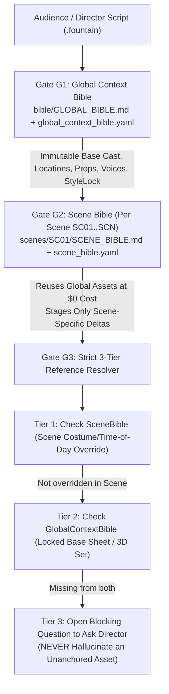

# AGY Studio v5 — Human-Readable Filmmaking & Production Bible (`GENERIC_BIBLE.md`)

> [!IMPORTANT]
> **How Bibles Work in the AGY Studio Starter Kit (Two-Part Architecture)**
> 1. **Tier-0 Universal Filmmaking Bible (`GENERIC_BIBLE.md` — Shipped Inside the Starter Kit)**:
>    This human-readable document (and its executable companion [`agy_studio/generic_bible.py`](file:///Users/girishnair/Desktop/GGN/AGY/MDC/agy_studio/generic_bible.py)) is bundled directly inside `AGY_STUDIO_STARTER_KIT.zip`. It locks the universal cinematography grammar, virtual cinema optical glass, 33 physical camera rigs, 7-layer visual + 4-layer audio prompt compiler, single-speaker lip-sync laws, and 3-tier anti-hallucination reference lookup used across **every** production.
> 2. **Per-Script Gate G1 Global Bible (`productions/<PROJECT_ID>/bible/GLOBAL_BIBLE.md`) & Gate G2 Scene Bibles (`scenes/<SC>/SCENE_BIBLE.md`)**:
>    Whenever an audience member or director feeds **any** screenplay into `.venv/bin/python -m agy_studio ingest <script.fountain>` and runs `.venv/bin/python -m agy_studio g1` (or `.venv/bin/python -m agy_studio bible`), AGY Studio automatically generates a human-readable Markdown **Global Bible** (`bible/GLOBAL_BIBLE.md`) and per-scene **Scene Bibles** (`scenes/SC01/SCENE_BIBLE.md`) tailored to that script.

---

## 1. Studio Control Modes & Content Formats

### 1.1 The 3 Operating Modes (`ControlMode`)

| Mode ID | Studio Mode Name | Gate Behavior (`G1` $\rightarrow$ `G6`) | Best For |
| :--- | :--- | :--- | :--- |
| **`director`** | **Ultimate Director Control** | Pauses for human visual review & explicit approval at **every** gate: `G1` Global Bible $\rightarrow$ `G2` Character/Location Sheets & 3D Set $\rightarrow$ `G3` Storyboard & 3D Camera Angles $\rightarrow$ `G4` Voice Auditions $\rightarrow$ `G5` Video Takes $\rightarrow$ `G6` DaVinci Resolve Cut. | Live stage demos, pilot episodes, and high-craft scenes. |
| **`hybrid`** | **Smart Hybrid Control** | Pauses at core creative gates (`G1`, `G3`, `G5`, `G6`), while **auto-passing `G2` and `G4`** whenever approved Global Bible character sheets, 3D sets, or locked voice prints are reused with zero new scene deltas. | Multi-episode series production where cast/locations are already locked. |
| **`autopilot`** | **Seamless End-to-End Autopilot** | Human approves `G1` (Global Bible) once; AGY runs `G2` through `G5` autonomously with `VisualContinuityCritic` QA self-healing (`threshold >= 0.85`), pausing at `G6` when the DaVinci Resolve timeline is ready. | Rapid overnight assembly and autonomous batch episodes. |

### 1.2 Supported Content Formats (`ContentFormat`)

| Format ID | Aspect Ratio | Target Framing & Pacing Grammar |
| :--- | :--- | :--- |
| **`microdrama_9_16`** | `9:16` (`1080x1920`) | Vertical mobile framing, tight medium/close-up coverage, 2–3s high-retention hook beats. |
| **`episode_16_9`** | `16:9` (`1920x1080` / `3840x2160`) | Episodic widescreen narrative coverage, balanced master/OTS/reverse-OTS geography. |
| **`feature_film`** | `16:9` / `2.39:1` | Theatrical widescreen/anamorphic staging, motivated camera movement, deep environmental blocking. |
| **`marketing_spot`** / **`commercial_ad`** | `9:16` or `16:9` | Time-coded multi-shot escalation (`0–3s` Macro Hook $\rightarrow$ `3–7s` Tactile Interaction $\rightarrow$ `7–12s` Slow-Mo Climax $\rightarrow$ `12–15s` Hero Pull-Out). |

---

## 2. Two-Layer Bible Hierarchy & Strict 3-Tier Anti-Hallucination Reference Lookup

To prevent character face drift, costume changes, or hallucinated room geometry across scenes, AGY Studio enforces a strict two-layer Bible hierarchy ([`agy_studio/bible_hierarchy.py`](file:///Users/girishnair/Desktop/GGN/AGY/MDC/agy_studio/bible_hierarchy.py)):



### How to View the Human-Readable Bibles via CLI
```bash
# View or refresh the full human-readable Global Bible (bible/GLOBAL_BIBLE.md)
.venv/bin/python -m agy_studio --project <PROJECT_ID> bible

# View or refresh a specific Scene Bible (scenes/SC01/SCENE_BIBLE.md)
.venv/bin/python -m agy_studio --project <PROJECT_ID> bible SC01

# View a specific Character, Location, Prop, or StyleLock record
.venv/bin/python -m agy_studio --project <PROJECT_ID> bible CHAR_RISHI
.venv/bin/python -m agy_studio --project <PROJECT_ID> bible STYLE_LOCK
```

---

## 3. Virtual Cinema Optical Glass (`6 Bodies × 11 Lenses × 3 Apertures`)

Every shot compiled by AGY Studio is anchored to a physical cinema camera body, optical lens family, focal length (`mm`), and T-stop/f-stop depth-of-field tier:

### 3.1 The 6 Virtual Cinema Camera Bodies (`CineCameraBody`)

| Enum Key | Optical & Sensor Signature Injections |
| :--- | :--- |
| **`ARRI_ALEXA_35`** | `ARRI Alexa 35 (Super 35, 17-stop dynamic range, organic filmic highlight rolloff)` |
| **`RED_V_RAPTOR`** | `RED V-Raptor 8K VV (VistaVision large format, razor-sharp modern contrast)` |
| **`SONY_VENICE_2`** | `Sony Venice 2 8K (Full-Frame dual base ISO, clean shadow detail & natural skin tones)` |
| **`PANAVISION_DXL2`** | `Panavision Millennium DXL2 (Large format, warm classical Hollywood color science)` |
| **`IMAX_MSM_9802`** | `IMAX MSM 9802 65mm 15-perf (Ultra-wide visceral immersion & zero distortion)` |
| **`ARRIFLEX_435_35MM`** | `Arriflex 435 35mm Film Camera (Kodak Vision3 500T 5219 halation & organic photochemical grain)` |

### 3.2 The 11 Cinema Optical Glass Lenses (`CineLens`)

| Enum Key | Glass Character, Bokeh & Flare Signature |
| :--- | :--- |
| **`COOKE_S4_PRIME`** | `Cooke S4/i Prime (warm 'Cooke Look' skin rendition, velvety shadow rolloff)` |
| **`ARRI_SIGNATURE_PRIME`** | `ARRI Signature Prime (ultra-clean modern glass, creamy bokeh, zero chromatic aberration)` |
| **`ZEISS_SUPREME_PRIME`** | `Zeiss Supreme Prime (crisp micro-contrast, gentle focus falloff)` |
| **`PANAVISION_PRIMO`** | `Panavision Primo Prime (classic cinematic warmth, subtle golden edge flare)` |
| **`HAWK_V_LITE_ANAMORPHIC`** | `Hawk V-Lite 2x Anamorphic (oval bokeh, horizontal blue streak flares, widescreen compression)` |
| **`ATLAS_ORION_ANAMORPHIC`** | `Atlas Orion 2x Anamorphic (modern vintage anamorphic character, signature cyan flares)` |
| **`CANON_K35_VINTAGE`** | `Canon K35 Vintage Prime (1970s low-contrast glowing highlights, warm pastel flares)` |
| **`HELIOS_44_2`** | `Helios 44-2 58mm Rehoused (swirly expressive background bokeh, dreamy subject isolation)` |
| **`PETZVAL_85_ART`** | `Lomography Petzval 85mm Art (tack-sharp center with dramatic radial field curvature)` |
| **`LAOWA_24MM_PROBE`** | `Laowa 24mm f/14 2x Macro Probe (bug-eye extreme close-up perspective through tight spaces)` |
| **`ANGENIEUX_OPTIMO_ZOOM`** | `Angenieux Optimo 24-290mm Cinema Zoom (rich theatrical compression & fluid focal transitions)` |

### 3.3 The 3 Canonical Cinema Aperture Tiers (`CineAperture`)

| Enum Key | Depth-of-Field Behavior |
| :--- | :--- |
| **`SHALLOW_F1_4`** | `f/1.4 (wide-open ultra-shallow depth of field, intimate subject isolation, melted background bokeh)` |
| **`BALANCED_F4`** | `f/4.0 (natural narrative depth of field, crisp subject with legible spatial environment)` |
| **`DEEP_F11`** | `f/11 (deep focus staging, foreground and background subjects simultaneously tack-sharp)` |

---

## 4. The 33 Physical Camera Rigs & Movement Primitives (`CameraRig33`)

| # | Rig ID | Physical Movement Description |
| :--- | :--- | :--- |
| 1 | `STATIC_TRIPOD` | Static locked-off fluid-head tripod |
| 2 | `SLOW_DOLLY_IN` | Slow motorized dolly push-in on precision track |
| 3 | `SLOW_DOLLY_OUT` | Slow motorized dolly pull-out revealing environment |
| 4 | `TRUCK_LEFT` | Lateral dolly truck left parallel to subject |
| 5 | `TRUCK_RIGHT` | Lateral dolly truck right parallel to subject |
| 6 | `PEDESTAL_UP` | Vertical column pedestal rise up |
| 7 | `PEDESTAL_DOWN` | Vertical column pedestal sink down |
| 8 | `PAN_LEFT` | Smooth fluid-head pan left |
| 9 | `PAN_RIGHT` | Smooth fluid-head pan right |
| 10 | `TILT_UP` | Smooth fluid-head tilt up reveal |
| 11 | `TILT_DOWN` | Smooth fluid-head tilt down reveal |
| 12 | `WHIP_PAN` | High-velocity kinetic whip pan with motion blur |
| 13 | `WHIP_TILT` | High-velocity vertical whip tilt |
| 14 | `STEADICAM_FOLLOW` | Floating Steadicam following behind subject at walking pace |
| 15 | `STEADICAM_LEAD` | Floating Steadicam leading backwards in front of walking subject |
| 16 | `STEADICAM_ORBIT_180` | Smooth 180-degree Steadicam arc orbit around subject |
| 17 | `ORBIT_360_HERO` | Continuous 360-degree circular dolly orbit around hero subject |
| 18 | `HANDHELD_INTIMATE` | Organic shoulder-mounted documentary handheld with subtle breathing micro-motion |
| 19 | `HANDHELD_CHAOTIC` | Urgent kinetic handheld combat/chase camera with visceral shake |
| 20 | `SNORRICAM_BODY_MOUNT` | Body-mounted SnorriCam locked to actor's chest (subject static, background spinning) |
| 21 | `CRANE_JIB_SWEEP_UP` | Sweeping Technocrane jib rise from ground level to high-angle overview |
| 22 | `CRANE_JIB_SWEEP_DOWN` | Sweeping Technocrane jib descent from high ceiling down to intimate close-up |
| 23 | `DUTCH_ANGLE_TENSION` | Canted 18-degree Dutch tilt rig for psychological unease |
| 24 | `LOW_ANGLE_HERO` | Floor-level low-angle hi-hat rig looking up at subject |
| 25 | `HIGH_ANGLE_VULNERABLE` | Overhead high-angle menace boom looking down at subject |
| 26 | `BIRDS_EYE_TOP_DOWN` | 90-degree vertical overhead God's-eye rig straight down |
| 27 | `WORMS_EYE_GROUND` | Recessed worm's-eye ground plate looking straight up |
| 28 | `DOLLY_ZOOM_VERTIGO` | Synchronized zolly (dolly-in while zooming-out) Vertigo perspective warp |
| 29 | `RACK_FOCUS_FG_TO_BG` | Precision follow-focus rack from foreground silhouette to background speaker |
| 30 | `RACK_FOCUS_BG_TO_FG` | Precision follow-focus rack from background action to foreground reaction |
| 31 | `PROBE_MACRO_GLIDE` | Motorized motion-control macro probe gliding through tabletop objects |
| 32 | `FPV_DRONE_DIVE` | Acrobatic cinewhoop FPV drone seamless interior-to-exterior thread |
| 33 | `CABLE_CAM_FLYTHROUGH` | Suspended wire-cam high-speed overhead tracking shot |

---

## 5. Deterministic 7-Layer Visual + 4-Layer Audio Prompt Compiler

Every image and video prompt compiled by [`compile_generic_bible_prompt()`](file:///Users/girishnair/Desktop/GGN/AGY/MDC/agy_studio/generic_bible.py#L253-L332) enforces:

### 5.1 The 7 Mandatory Visual Layers (`SevenLayerVisualSpec`)
1. **Subject**: Canonical character/prop appearance locked to `[Image1]`..`[ImageN]` reference sheets.
2. **Context**: Spatial room geometry locked to the `set3d` / Blender `cam:<NAME>` viewport render.
3. **Action**: Precise physical blocking and micro-expression beat.
4. **Style**: Locked to the project's `StyleLock`.
5. **Camera**: Optical glass + focal length + aperture + 1 of the 33 physical camera rigs.
6. **Composition**: Foreground/midground/background depth staging (computed from 3D view-space coordinates).
7. **Ambiance**: Practical light sources, color temperature, and atmospheric texture.

### 5.2 The 4 Mandatory Audio & Lip-Sync Layers (`FourLayerAudioSpec`)
1. **Single-Speaker Lip-Sync Law**:
   - **On-Screen Dialogue (`off_screen=False`)**: `ONLY <SPEAKER_ID> speaks and lip-syncs; all other visible characters keep mouths 100% CLOSED.`
   - **Off-Screen / VO / Silent Reaction (`off_screen=True`)**: `ALL visible characters keep mouths 100% CLOSED.`
2. **Human Speech Pacing Budget (`dialogue_agent.py`)**:
   - `2.2 words/sec` (`5–8 words` per `5s` clip, `8–14 words` per `8s` clip) with mandatory `0.6s` pre-roll and post-roll breath cushions.
   - Native script + phonetic transliteration + `[acoustic delivery tags]` rendered via **Gemini TTS 3.8 (`gemini-3.8-tts`)**.
3. **Explicit 4-Layer Audio Separation**:
   - **Layer 1 (Dialogue)**, **Layer 2 (Ambient Room Tone)**, **Layer 3 (Foley/SFX)**, **Layer 4 (Music)** + mandatory `(no subtitles)` guard so video models never hallucinate studio laughter or burned-in text.
