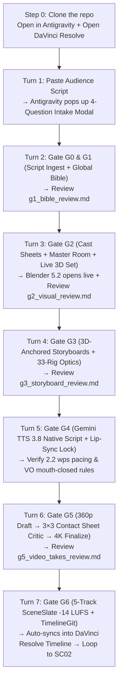

# 🎬 AGY Studio v5 — Shareable Starter Kit & Deterministic Live Demo Runbook

This document is both your **On-Stage Presenter Runbook** and the **Post-Demo Audience Handoff Guide**. The
repository itself is the starter kit: `git clone https://github.com/girishnair-source/ArgonCreativeWorkflow.git`
(or download the GitHub ZIP) and open the folder in Antigravity.

---

## 1. The Shareable Audience Starter Kit (this repository)

All root causes are fixed directly in the `agy_studio` codebase (no scratch scripts, no manual workarounds, no
offline stand-ins), so the clean, project-agnostic repository is what you share with your audience after the talk.

### What Is Inside the Repository (Verified Core Paths)

| Component | Included Files in Starter Kit | Purpose for Audience & Live Demo |
| :--- | :--- | :--- |
| **1. Agent Rules & Anti-Hallucination Contract** | [`GEMINI.md`](./GEMINI.md), [`.agents/AGENTS.md`](./.agents/AGENTS.md), [`.agents/skills/autonomous-director/`](./.agents/skills/autonomous-director/SKILL.md) | Enforces Zero-Touch Editor Mode, Mandatory Turn-1 `ask_question` Intake, Visual-Artifact-First Gate Lock, and 3-Anchor Reference Chain. |
| **2. Core AGY v5 Harness Engine** | [`agy_studio/`](./agy_studio) (`harness_v5.py`, `generic_bible.py`, `orchestrator.py`, `cli.py`, `registry.yaml`, `adapters/`, `set3d/`) | Native CLI (`python -m agy_studio ...`) with auto-detected `gcloud` project/token fallback, `360p` $\rightarrow$ `4K` DraftFinalize (`reuse_prompt_on_finalize=True`), `GeminiTTS38Line`, `3×3` Contact Sheet Critic, `33-Rig` Optical Matrix, `5-Track SceneSlate`, `StateTokenGuard`, and `TimelineGitRepo`. |
| **3. Procedural 3D World & Blender 5.2 Exporter** | [`agy_studio/set3d/designer.py`](./agy_studio/set3d/designer.py), [`blender_export.py`](./agy_studio/set3d/blender_export.py), [`stylepass.py`](./agy_studio/set3d/stylepass.py) | Converts **any** script location into `set.json`, `.blend`, `cam_renders_9_16/<CAM>_3d_clean.png`, and `<ENV_ID>_FPV_Director.html` (`60 FPS` browser FPV). |
| **4. DaVinci Resolve MCP & NLE Sync** | [`resolve_mcp_server.py`](./resolve_mcp_server.py), [`resolve_sync_trigger.py`](./resolve_sync_trigger.py), [`mcp_config.json`](./mcp_config.json) | Pushes multi-track video/audio cuts, `-14 LUFS` stems, subtitles, and markers directly into DaVinci Resolve Free/Studio. |
| **5. One-Command Setup & Pre-Flight** | [`setup_studio_env.sh`](./setup_studio_env.sh), [`live_demo_preflight.py`](./live_demo_preflight.py), [`LIVE_DEMO_RUNBOOK.md`](./LIVE_DEMO_RUNBOOK.md) | Bootstraps `.venv`, `ffmpeg`, and `gcloud`, and verifies all v5 harness guards in `< 2s`. |
| **6. Empty `productions/` Workspace** | `productions/.gitkeep` | Clean slate where the user's or audience's new show (`productions/<PROJECT_ID>/`) is created. |

---

## 2. Code-Level Fixes Made So Zero Workarounds Are Needed

We eliminated every root cause that required manual intervention earlier:

1. **Auto-Detected GCP Project & Token Fallback ([`agy_studio/adapters/base.py`](./agy_studio/adapters/base.py) & [`image.py`](./agy_studio/adapters/image.py))**:
   - Previously, `vertex_project_id()` defaulted to a hardcoded internal project ID (`ggn-non-prod-462303`), causing `403 PERMISSION_DENIED` when running native CLI commands.
   - **Fixed**: `vertex_project_id()` reads `VERTEX_PROJECT_ID` $\rightarrow$ `GOOGLE_CLOUD_PROJECT` $\rightarrow$ `gcloud config get-value project` and **stops with the `gcloud config set project` instruction when none is set** (no hidden default project). `gemini_client()` retries exactly once with `gcloud auth print-access-token` on an ADC `401`/`403`; if gcloud itself cannot mint a token the run stops immediately with gcloud's real error text (e.g. *Access was blocked by Context Aware Access*) and the fix commands — see [`agy_studio/adapters/auth.py`](agy_studio/adapters/auth.py).
   - **Fail-fast rule**: a credential problem is never retried with new seeds, never handed to the next provider model and never replaced by offline output (macOS `say`, `ffmpeg zoompan` stills, a fake generation backend). `live_demo_preflight.py` now mints a real token and exits `1` with the same message, so run it before `G4`.
2. **Automatic `/opt/homebrew/bin` PATH Injection ([`agy_studio/adapters/base.py`](./agy_studio/adapters/base.py))**:
   - `ffmpeg`, `ffprobe`, `gcloud`, and `blender` are automatically resolved in non-interactive shells without needing manual `export PATH=...` — including Homebrew's `/opt/homebrew/share/google-cloud-sdk/bin`, the Caskroom SDK, `~/google-cloud-sdk/bin`, snap and Windows SDK paths.
3. **Automatic Batch 3D Camera Rendering in `open_in_blender.py` ([`agy_studio/set3d/blender_export.py`](./agy_studio/set3d/blender_export.py))**:
   - Running `open_in_blender.py -- --save-and-render` now saves `<ENV_ID>.blend` **and** automatically renders every `CAM_<NAME>` in the 3D set to `cam_renders_9_16/<NAME>_3d_clean.png` for any environment generated from any audience script.
4. **3-Anchor Reference Chain in Storyboard & Stylepass ([`agy_studio/orchestrator.py`](./agy_studio/orchestrator.py) & [`stylepass.py`](./agy_studio/set3d/stylepass.py))**:
   - Every Gate G3 shot automatically passes `(1) 3D Camera Blockout PNG` + `(2) Approved G2 Master Room Plate` + `(3) Approved G2 Character Sheet(s)` so character faces, outfits, and room furniture never drift across angles.

---

## 3. Exact Step-by-Step Runbook (For Your Live Stage Demo & For Audience Members Post-Demo)



### Pre-Demo Setup (Run Once Before Going on Stage, or Step 1 for Audience Members)
Open the folder in **Antigravity**, open **DaVinci Resolve**, and paste:
> **"Run `live_demo_preflight.py` to verify the studio environment is ready."**

*(If an audience member is running it for the first time on a new Mac, Antigravity automatically runs `bash setup_studio_env.sh` and `gcloud auth login`.)*

---

### Turn 1 — Audience Script Input & Mandatory 3-Mode Intake (`Step 0`)
- **Prompt to Paste on Stage**:
  > **"Create a new project named `LIVE_DEMO` from this audience script. Let's run Scene 1 (`SC01`, 3 shots) end-to-end through all gates into DaVinci Resolve:**
  > **[PASTE AUDIENCE SCRIPT OR 3-SENTENCE SCENE IDEA HERE]"**
- **Exact Agent Behavior (`ask_question` Modal)**:
  - Antigravity immediately pops up the **4-Question Interactive Modal**:
    1. **Operating Mode (`ControlMode`)**:
       - `Mode 1 — Director Control` *(Stops for your review at every gate `G1` $\rightarrow$ `G6` — recommended for live demo)*
       - `Mode 2 — Smart Hybrid` *(Stops at `G1`, `G3`, `G5`, `G6`; auto-passes `G2`/`G4` when reusing assets)*
       - `Mode 3 — Autopilot` *(Approve `G1` once; runs `G2` $\rightarrow$ `G5` autonomously to `G6` Resolve cut)*
    2. **Content Format (`ContentFormat`)**: `Vertical Microdrama (9:16)`, `20-Minute Episode (16:9)`, `Feature Film (2.39:1)`, or `Commercial Spot`.
    3. **3D Blocking Engine**: `Native Blender 5.2 (.blend)`, `Zero-Blender 60 FPS Browser 3D FPV`, or `Both`.
    4. **Existing Reference Sheets (`casting-agent`)**: Select *"Generate new Character & Location Reference Sheets live from the script"*.

---

### Turn 2 — Gate G0 (Script Ingest) & Gate G1 (Global Bible)
- **Native CLI Executed by Antigravity**:
  ```bash
  .venv/bin/python -m agy_studio init LIVE_DEMO "Audience Live Demo" --aspect 9:16 --mode director --format microdrama_9_16
  .venv/bin/python -m agy_studio --project LIVE_DEMO ingest productions/LIVE_DEMO/script/script_v1.fountain
  .venv/bin/python -m agy_studio --project LIVE_DEMO g1
  ```
- **What You & the Audience See**:
  - Antigravity presents `g1_bible_review.md` showing the extracted **Characters** (`CHAR_*`), **Props** (`PROP_*`), **Environments** (`ENV_*`), **StyleLock** (`camera_body`, `Cooke S4/i` lenses), and **Gemini TTS 3.8 Voice Profiles**.
- **Your Action**:
  - Comment on `g1_bible_review.md` if you want any character/style change, or reply: **"Approve G1 and proceed to Gate G2."**

---

### Turn 3 — Gate G2 (Character Sheets, Master Location Plate & Live 3D World Creation)
- **Native CLI Executed by Antigravity**:
  ```bash
  .venv/bin/python -m agy_studio --project LIVE_DEMO gate G1 "approve all"
  .venv/bin/python -m agy_studio --project LIVE_DEMO design SC01 generate
  .venv/bin/python -m agy_studio --project LIVE_DEMO set3d build <ENV_ID>
  .venv/bin/python -m agy_studio --project LIVE_DEMO set3d export-blender <ENV_ID>
  /Applications/Blender.app/Contents/MacOS/Blender -b productions/LIVE_DEMO/bible/sets/<ENV_ID>/blender/open_in_blender.py -- --save-and-render
  open -a /Applications/Blender.app productions/LIVE_DEMO/bible/sets/<ENV_ID>/blender/<ENV_ID>.blend
  ```
- **What You & the Audience See**:
  1. **Blender 5.2 pops open live on your screen** showing the procedurally generated 3D room, furniture blocks, articulated character mannequins, and 3D camera frustums (`CAM_WIDE_MASTER`, `CAM_OTS_*`, `CAM_CLOSE_HERO`)!
  2. Antigravity presents `g2_visual_review.md` embedding all generated **Character Turnaround Sheets** (`front.png`, `face_closeup.png`), **3D Camera Blockouts**, and the **Photorealistic Master Room Plate** (`cam_WIDE_MASTER.png`).
- **Your Action**:
  - Leave inline comments on `g2_visual_review.md` (or adjust a camera in Blender and tell Antigravity to `reanchor`), then reply: **"Approve G2 and proceed to Gate G3."**

---

### Turn 4 — Gate G3 (3D-Anchored Storyboard Keyframes & 33-Rig Optical Matrix)
- **Native CLI Executed by Antigravity**:
  ```bash
  .venv/bin/python -m agy_studio --project LIVE_DEMO gate G2 SC01 "approve all"
  .venv/bin/python -m agy_studio --project LIVE_DEMO direct SC01
  ```
- **What You & the Audience See**:
  - Antigravity decomposes `SC01` into 3 shots (`SC01_SH01`, `SC01_SH02`, `SC01_SH03`), assigns each shot a physical camera/lens/aperture/rig from the **33-Rig Optical Matrix**, generates the photorealistic keyframes using the **3 locked reference anchors** (`3D Camera Blockout` + `Master Room Plate` + `Character Sheets`), and presents `g3_storyboard_review.md`.
- **Your Action**:
  - Review `g3_storyboard_review.md` and reply: **"Approve G3 and proceed to Gate G4."**

---

### Turn 5 — Gate G4 (Gemini TTS 3.8 Native Script Dialogue & Single-Speaker Lip-Sync Gate)
- **Native CLI Executed by Antigravity**:
  ```bash
  .venv/bin/python -m agy_studio --project LIVE_DEMO gate G3 SC01 "approve all"
  .venv/bin/python -m agy_studio --project LIVE_DEMO audio SC01
  ```
- **What You & the Audience See**:
  - Validates every line with [`GeminiTTS38Line`](./agy_studio/harness_v5.py) (`2.2 words/sec` budget, `0.6s` breath cushions, native script + `[acoustic delivery tags]` preserved for `gemini-3.8-tts`, and strict on-screen vs. off-screen `100% CLOSED` mouth rules).
- **Your Action**:
  - Reply: **"Approve G4 and run Gate G5 Two-Tier Video Generation."**

---

### Turn 6 — Gate G5 (Two-Tier `360p` Draft → `3×3` Contact Sheet Critic → `4K` Finalize)
- **Native CLI Executed by Antigravity**:
  ```bash
  # Real generation only: approving G4 (or `advance SC01`) sends every linted clip to Omni/Veo through the adapters.
  .venv/bin/python -m agy_studio --project LIVE_DEMO gate G4 "approve all"
  .venv/bin/python -m agy_studio --project LIVE_DEMO advance SC01
  # Inspect any take: 9 frames across the whole clip + measured motion + critic verdict
  .venv/bin/python -m agy_studio --project LIVE_DEMO contact-sheet productions/LIVE_DEMO/scenes/SC01/takes/<TAKE_ID>/take.mp4
  ```
- **What You & the Audience See**:
  1. **Tier 1 (`360p` Fast Draft)**: The video adapter generates fast `360p` draft takes via **Gemini Omni 1.5 Flash (`gemini-omni-1.5-flash`)** (registry `draft_resolution`). There is no stub or placeholder path — a take that is not a real moving-picture render from the provider is hard-rejected (`static_video` / `unprovenanced_video`).
  2. **`3×3` Contact Sheet & 6-Mode Continuity Critic**: Extracts the 9-frame temporal contact sheet and scores it across 6 continuity failure modes (`identity_drift`, `lighting_mismatch`, `prop_disappearance`, `wardrobe_mutation`, `eyeline_violation`, `spatial_scale_break`).
  3. **Tier 2 (`4K` Finalize)**: Promotes the winning take (`score >= 0.85`) to **`4K`** reusing the **exact same prompt, seed, and references** (`reuse_prompt_on_finalize=True`), and presents `g5_video_takes_review.md`.
- **Your Action**:
  - Reply: **"Approve G5 and push Scene 1 to DaVinci Resolve (Gate G6)."**

---

### Turn 7 — Gate G6 (5-Track `SceneSlate` Promotion, `TimelineGit` & Live DaVinci Resolve Cut)
- **Native CLI Executed by Antigravity**:
  ```bash
  .venv/bin/python -m agy_studio --project LIVE_DEMO slate promote SC01 --require-4k
  .venv/bin/python -m agy_studio --project LIVE_DEMO timeline-git head
  .venv/bin/python resolve_sync_trigger.py --project LIVE_DEMO --scene SC01
  ```
- **What You & the Audience See**:
  - Promotes the 5-track `-14 LUFS` `SceneSlate` (with automatic music sidechain ducking `none|light|medium|heavy` and `StateTokenGuard`), records a Git-style commit in `TimelineGitRepo` (supporting instant `undo` / `redo` / `branch` / `PR`), and populates your open **DaVinci Resolve** timeline live on screen!
  - **Scene Loop**: Antigravity then asks if you want to loop to `SC02` in `director` mode or let `SC02+` run in `autopilot` mode!
